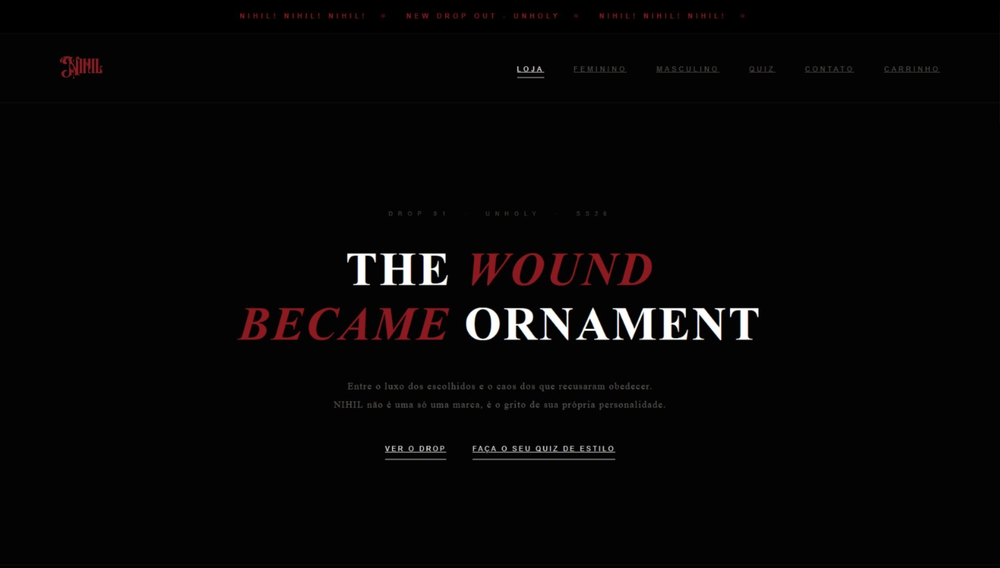
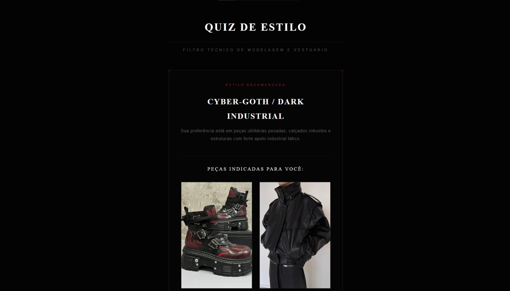
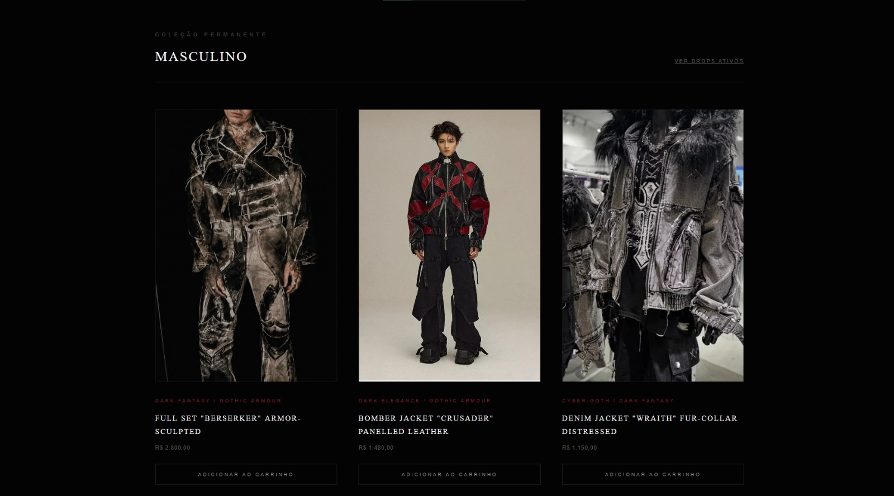
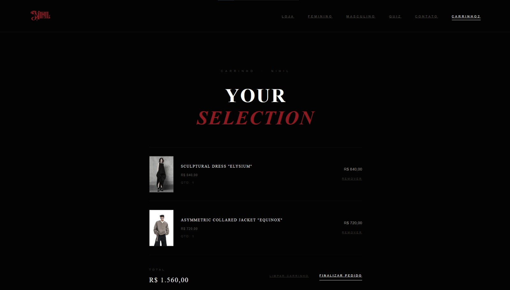

# NIHIL — Loja Virtual de Moda

**Universidade Tuiuti do Paraná | 2026**


## Sobre o trabalho

Projeto desenvolvido como atividade acadêmica da disciplina de **Programação Web**, do curso de Análise e Desenvolvimento de Sistemas da Universidade Tuiuti do Paraná (UTP).

O trabalho consiste em uma loja virtual de moda gótica/sombria, chamada **NIHIL**. A aplicação foi desenvolvida utilizando PHP, HTML e CSS, sem uso de banco de dados.

## Pré-visualização

| Home | Quiz |
|---|---|
|  |  |

| Coleção | Carrinho |
|---|---|
|  |  |

## Objetivos

Desenvolver uma aplicação web dinâmica capaz de:

- Exibir produtos em vitrines organizadas por coleção;
- Manter o estado de um carrinho de compras durante a navegação;
- Validar dados enviados por formulário no servidor;
- Recomendar produtos a partir das respostas de um quiz.

## Tecnologias utilizadas

- PHP 8
- HTML5
- CSS3

## Implementação

O projeto contempla:

- Vitrines de produtos em páginas separadas (drop atual, feminino e masculino);
- Carrinho de compras com sessões PHP (adicionar, remover e limpar itens);
- Contador de itens do carrinho exibido no menu;
- Menu dinâmico que destaca a página atual;
- Formulário de contato com validação no servidor;
- Quiz de estilo com 3 perfis de resultado e recomendação de produtos;
- Escape de saída com `htmlspecialchars` nos dados exibidos.

## Como executar

Requer **PHP 8 ou superior**.

```bash
git clone https://github.com/pe-vargas/nihil.git
cd nihil
php -S localhost:8000
```

Em seguida, acessar `http://localhost:8000` no navegador.

## Estrutura do projeto

```text
index.php        página inicial e drop atual
f.php            coleção feminina
m.php            coleção masculina
quiz.php         quiz de estilo
carrinho.php     carrinho de compras (sessões PHP)
contato.php      formulário de contato

css/             estilos por página
img/             imagens do site
screenshots/     capturas de tela deste README
```

Cada pasta possui seu próprio README: [css](css/README.md) · [img](img/README.md) · [screenshots](screenshots/README.md)

## Limitações

- Os produtos são definidos em arrays dentro dos arquivos `.php`, sem banco de dados;
- O formulário de contato valida os campos, mas não envia e-mail;
- Não há checkout nem pagamento.

## Autor

- Pedro Dambiski de Vargas

## Informações acadêmicas

| Informação | Detalhes |
|---|---|
| Instituição | Universidade Tuiuti do Paraná (UTP) |
| Curso | Análise e Desenvolvimento de Sistemas |
| Disciplina | Programação Web |
| Professor | Luiz Adolpho Baroni |
| Período | Primeiro Semestre de 2026 |
| Tipo | Trabalho acadêmico individual |

---

**Observação:** Este repositório tem finalidade acadêmica e documental, reunindo os arquivos desenvolvidos para a atividade proposta na disciplina. Os produtos e marcas exibidos são fictícios.
